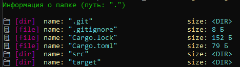

# dir_info

Консольная утилита на Rust для просмотра информации о файлах и папках в директории для Windows.

## Как пользоваться
Скачайте `dir_info.exe` из раздела **Releases**.
Откройте терминал (cmd или PowerShell) в папке с утилитой и напишите (вместо `C:\Windows` вы можете написать другой путь):

```powershell
dir_info.exe C:\Windows
```


